# Yard Shade Studio

Plan a yard and see where the shade falls, at any time of day, on any date, anywhere on Earth.

## v2: the living diorama (this branch)

Inspired by three pieces of web work: Lusion's *Of the Oak* (a procedurally grown oak as a living system), Shader's *eHealth Arena* (a scene presented as a diorama on a studio plinth), and Gavin Shapiro's *Firewood* (scanned materials, soft light). v1 is kept unchanged on the `claude/yard-shade-simulator-threejs-q8uehi` branch.

- **Botanical trees.** Every tree is grown, not modelled:
  - **Broadleaves** grow by space colonization (branches reach toward light points filling the species' crown), then fan into fine twigs, and taper by the pipe model.
  - **Conifers** grow a whorl of branches a year with branchlets. Norway spruce's hang in curtains.
  - **Leaves** are individual instances in the species' true shape and arrangement: opposite pairs on maples, alternate on lindens, a fiddle outline on bur oak, pinnae on honeylocust. They're lit from both sides, with pale undersides and sun glowing through.
  - **143 trees.** 79 are tagged with their USDA hardiness range (zones 2–9): sugar, red, silver and Japanese maples, boxelder, northern pin and red oaks, Kentucky coffeetree, buckeyes, Japanese tree lilac, serviceberry, Canada Red chokecherry, plums, hawthorns, mountain ash, pagoda and flowering dogwoods, ironwood, blue beech, ginkgo, tamarack, magnolia, redbud, sweetgum, tulip tree, black gum, firs, white and Scotch pines, weeping white spruce, and the trees already in many older yards (green ash, cottonwood, Siberian elm).
  - 64 more come from northern garden-centre lists (Freeman, sugar and Amur maples, lindens, Dakota Pinnacle and Prairie Dream birches, disease-resistant elms, NDSU oaks and honeylocust, a dozen crabapples, Amur chokecherries, smoke trees, tree lilacs, catalpa, katsura, and more arborvitae, junipers and spruces). These grow from the closest species profile and have no zone tag yet.
  - Special growth where the species needs it: pagoda dogwood in flat tiers, weeping white spruce with limbs hanging against the trunk, tamarack needles that turn gold and drop, compound leaves (ash, coffeetree, buckeye, mountain ash), a fan for ginkgo, square-tipped tulip tree leaves, braided scale-leaf sprays for junipers (distinct from arborvitae's flat fans).
  - **Research.** Species data comes from arboretum and extension fact sheets; see [docs/botany.md](docs/botany.md).
- **Seasons in the trees.** Everything is timed from the leaf-out and leaf-drop dates, shifted per species (buckeyes leaf out a week early and are bare by mid-September; Kentucky coffeetree is two weeks late and drops early; willows hold on late). The shade maps follow the same calendar.
  - Leaves expand over the fortnight after leaf-out.
  - Fall colour starts on the outer leaves; then leaves drop a few at a time, and litter builds under the tree and is gone three weeks later.
  - Crabapples (Prairifire, Snowdrift) and Honeycrisp apple blossom for two weeks at leaf-out; Honeycrisp's apples ripen red in September. Redbud, magnolia, plums and serviceberry flower on bare wood. Lilac plumes open in June. Hydrangea panicles go lime, then white, then pink.
  - Prairifire's maroon spring leaves settle to a dark red-bronzed green, and Canada Red chokecherry turns deep red through June; ginkgo turns gold and drops nearly all at once.
  - Lindens carry their June bracts; acorns, pods, crabapple fruit and alder cones hang into winter; spruces carry their cones.
- **Trees grow over time.** Give a tree the year it was planted, its height at planting and (optionally) your own growth rate; new trees go in this year at nursery size, then use **Trees in** on the sun card to see the yard 5, 10 or 20 years on.
  - Each species grows at its own rate, from the Arbor Day Foundation's classes (slow ≤ 12 in a year, medium 13–24 in, fast ≥ 25 in) and extension fact sheets; cultivars can differ (Autumn Blaze ~3 ft a year, Black Hills spruce ~1 ft).
  - Height and width at planting both fill in from the species and can be changed to match the tree as it stands. Narrow trees (columnar birch, Spartan juniper) fill out to their mature width earlier, on their own clock: a Parkland Pillar birch is about 3 ft wide at 7 years and 5 ft by 10.
  - The planting year is a settling-in year; the first growing season is the next spring. Change the growth rate per tree if yours runs faster or slower than the species typical ("Use typical" puts it back).
  - Newly planted trees spend about a growing season per inch of trunk caliper establishing ("sleep, creep, leap"), then grow at full speed, slowing as they near mature height.
  - Broadleaves grow up before they grow out and fill in last, so young trees cast lighter shade; conifers keep their shape.
  - The tree's panel charts height and crown width over the years and lists its size at +5, +10 and +20 years.
- **Fences anywhere.** **Add to yard → Fence** draws a fence you reshape like a driveway: drag posts, add bends, extend past the end. **Make sides reshapeable** (Lot) turns the property-line fence into such fences. Property-line sides can also run part way.
- **Build and Observe.** **Observe** (rail, or **O**) locks the layout and lets you look around, **Walk** the yard at eye height (W A S D, Shift to run, drag to look), or fly a **Drone** from the ground up to 200 ft (Space/E up, Q/C down, scroll for speed). Buildings, decks, fences and tree trunks are solid, and walkers stay inside the property line. In Build, the lock button (**L**) keeps items from being dragged or reshaped by accident.
- **Guided start.** First launch offers a four-step guide (map your lot, add buildings and hardscape, plant trees, observe) that points at each control and moves on as you do it, with one-off tips as you open panels. **Tutorial** in the rail brings it back.
- **Schematic view** marks every tree's centre with a dot.
- **Diorama stage** (Display → Stage).
- **Find on a map** (Lot panel): search an address with OpenStreetMap's free Nominatim search, line the outline up on Esri aerial imagery (or USGS / street map), drag corners, add or remove them, and bring the shape in to scale. It also sets the plan's location and time zone. Needs the app on its own site; pages shown inside claude.ai can't load outside maps.
- **Plans save themselves.** New plan asks for a name and where to keep it: a .json file on your computer (Chrome and Edge, where the page can write files) or this browser. Changes autosave every 10 minutes, a recovery copy is kept each minute, and the last plan reopens on your next visit. File → Recent plans switches between them.
- **Crabapples** leaf out with the other deciduous trees and bloom on calendar dates: 27 April, fading from 22 May. Deciduous trees leaf out on 21 April by default (plans on the old 5 May default move with it).
- **Opens on a real lot**: a Fargo, ND yard with its house, shed, deck, driveway and 29 young trees planted this year. Start a blank yard from the welcome screen.
  - **Diorama:** the lot is cut from the earth, its edge showing turf over a scanned soil profile, on a plinth in a studio. The sky still lights it. Tilt-shift grows as you pull back.
  - **Landscape:** keeps the open-country view.
- **Sun path.** Today's sun path arcs over the yard with hour beads and the sun riding it.
- **Scanned materials.** CC0 bark, soil, mulch, lawn detail and leaf litter from Poly Haven. Birch bark is painted.
- **Light.** AgX filmic tone mapping, HDR bloom for the sun, softer ambient occlusion.
- **Photo mode** (camera button or **P**). A path-traced still of the current view (three-gpu-pathtracer). It refines while you wait; **Save image** downloads a PNG.


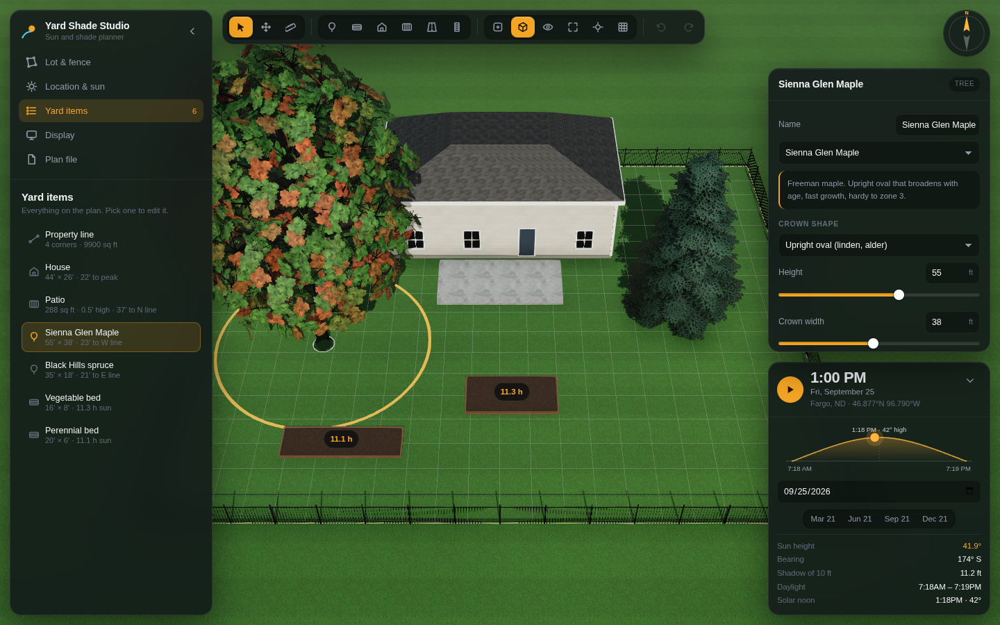

**Just want to run it?** Download the ZIP (or clone) and double-click `yard-shade-studio.html`. It's the whole app in one file and works straight from disk, no install or server needed. Opening `index.html` from disk forwards you to it. An internet connection only adds the web fonts and a sharper sky photo; without one it falls back to the bundled sky.

To work on the code:

```bash
npm install
npm run dev            # http://localhost:5173
npm run fetch-assets   # optional: 4k Poly Haven sky HDRI (~25 MB) into public/hdri
npm run build:standalone   # rebuild yard-shade-studio.html after changing the code
```

`index.html` is the development page: it loads the source modules, so it needs `npm run dev` (browsers block module scripts on `file://` pages).

The original single-file app is kept for reference at `legacy/yard-shade-studio-original.html`.

## What it does

All of the original planner's features are here, in a quieter "field notebook" interface: deep green panels, ivory type, brass accents, Instrument Serif for names and Geist Mono for every number.

- **Layout:**
  - A left icon rail (Lot, Plants, Sun, Items, Display, File). Each opens a flyout panel beside it; click the same icon again to close it.
  - A project card (plan name, place, lot size, save state) and the toolbar along the top.
  - The sun card bottom-left, map layers along the bottom, and the inspector on the right while something is selected.
  - On phones the rail becomes a bottom tab bar, and panels and the inspector open as bottom sheets.
- **Toolbar:**
  - Select, pan and measure.
  - **Add to yard**: a tree from the species library, or a raised bed, planting bed, building, deck, driveway or sidewalk.
  - Plan / 3D / Eye level, frame the lot, centre on the selection, schematic view, undo and redo. Keyboard: 1 / 2 / 3 / 0 / F / G, Esc to cancel or deselect.
- **Map layers:** shadows now, the sun-hours heat map, grid, schematic, and plant symbols for planting beds.
- **Sun card:**
  - Drag the sun arc to set the time, or play the day.
  - Pick a date, click the day-length ribbon to move through the year, or jump to a solstice or equinox.
  - Readouts show sun height, bearing, the shadow cast by a 10 ft object, daylight and solar noon.
- **Species library:** every tree drawn to the same scale.
  - Grouped Deciduous → genus (maples, lindens, birches, oaks…) and Evergreen → genus (spruces, pines, junipers & arborvitae).
  - Filter by type, mature height, shade density, flowering and hardiness zone (taken from the yard's location, or pick one), or search.
  - **Large** or **Compact** cards; compact fits about twice as many trees on screen.
  - Tags flag invasive species and emerald ash borer risk.
  - Place one, or use it to change the species of the selected tree.
- **Tree inspector:**
  - A to-scale elevation (height, crown width, a 6 ft figure). Drag its brass line to set **canopy starts at** (ft, 0.5 ft steps). The shade engine uses it too.
  - Crown shape tiles; height, width, canopy and leaf-density sliders; evergreen.
  - A mini plan of the tree's clearance to the property lines.
- **Bed inspector:**
  - A ring gauge of sun hours against daylight.
  - Hour-by-hour sun through the day and average sun for each month of the season.
  - Plants that suit that much sun.
- **Lot & fence:**
  - A plan of the lot with side lengths and fenced sides, lot stats and size.
  - Fence style tiles showing the share of sun each blocks, fence height, density and sides.
  - House angle vs. north with a dial.
- **Also:** location and clock (see below), the heat map threshold and bare branches in the off-season, render settings, every object in the yard with its size and distance to the property line, and JSON plan files. Undo and redo keep 60 steps. You can import a property image to trace and scale the lot.

### Planting beds

A planting bed is an in-ground bed of perennials, grasses, groundcovers and shrubs. It sits in the yard like any other object, so it gets the same sun-hours reading and shows up in the 3D views.

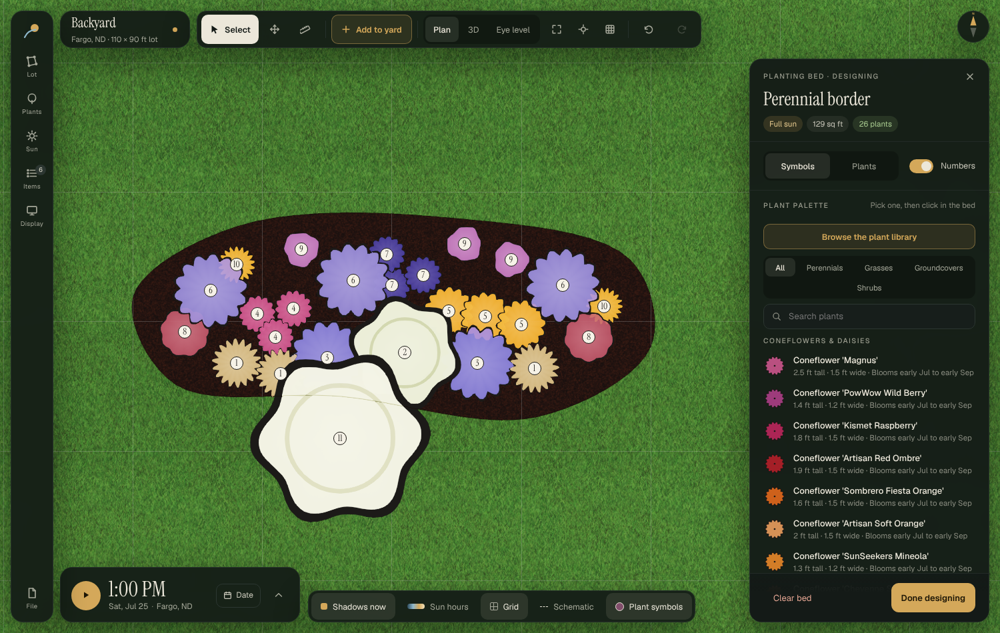
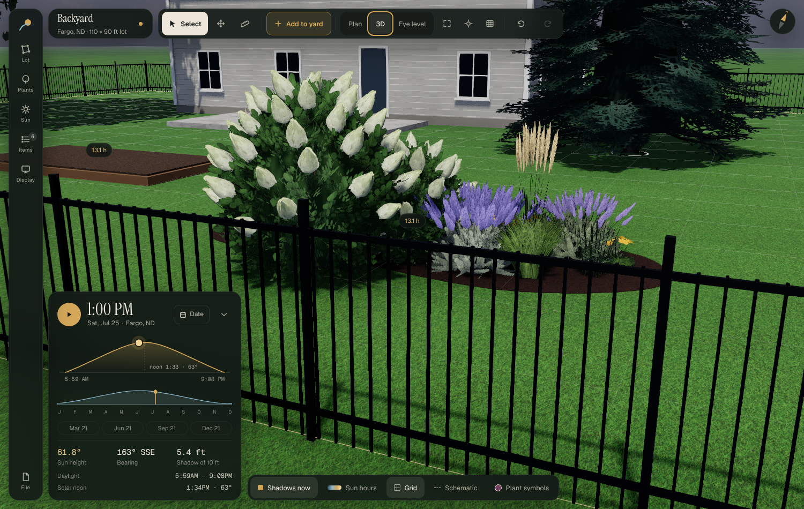

- **Plant library:** 197 perennials, grasses, groundcovers, shrubs and evergreen shrubs, each pictured in bloom from its own 3D model. Open it from **Add to yard → Perennial or shrub**, from **Plants** in the rail, or from the designer. Filter by type, sun, flower colour and height, or search.
- **Shape:** any outline. Reshape it corner by corner like a driveway; **Curved edge** runs a smooth curve through the corners. Surface is bark, soil, gravel or lawn.
- **Edit this bed** (or double-click the bed) opens the designer:
  - The view drops to Plan and frames the bed. Trees whose canopy would cover it step aside while you work.
  - Pick a plant in the palette, then click in the bed once for each one. Esc stops placing.
  - Plants go exactly where you click. There is no grid, and circles may overlap or reach past the edge.
  - Drag to move, Alt-drag to copy, Delete to remove. Delete never removes the bed while the designer is open.
- **Symbols or plants:** symbols are the planting-plan view (a circle the width of the mature plant, coloured by its flowers, with an edge that says what kind of plant it is). Plants are the 3D models. The switch is in the designer, and under **Plant symbols** in the map layers for the whole yard. Plan / 3D / Eye level work in both.
- **Numbers:** every plant of a kind carries the same number, listed in the planting key with a count.
- **Sun check:** select a plant to see the hours of sun at that spot and whether it suits the plant. The palette flags plants that want different light from the bed's average.
- **Seasons:** flowers appear inside each plant's bloom dates, and panicle and smooth hydrangeas change colour through theirs (lime, then white, then pink). Leaves take their fall colour before leaf drop. Out of season, perennials are cut back, grasses and seedheads stand tan, hydrangeas keep their dried heads on bare stems, dogwoods show their coloured canes and evergreens stay.
- **Shade:** shrubs and perennials 2.5 ft and taller cast shade in the sun-hours maths, on the lawn, on other beds and on the heat map. A bed's own reading ignores its own plants, so a spot is not called shady because of the plant meant to grow there.

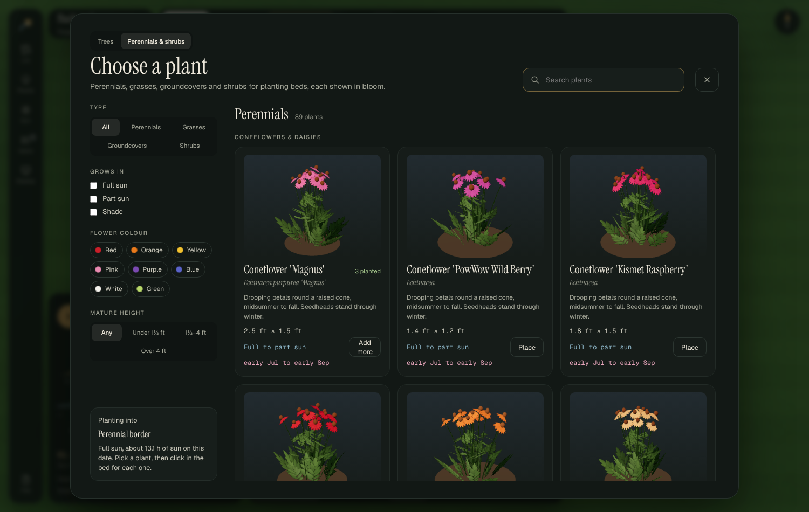
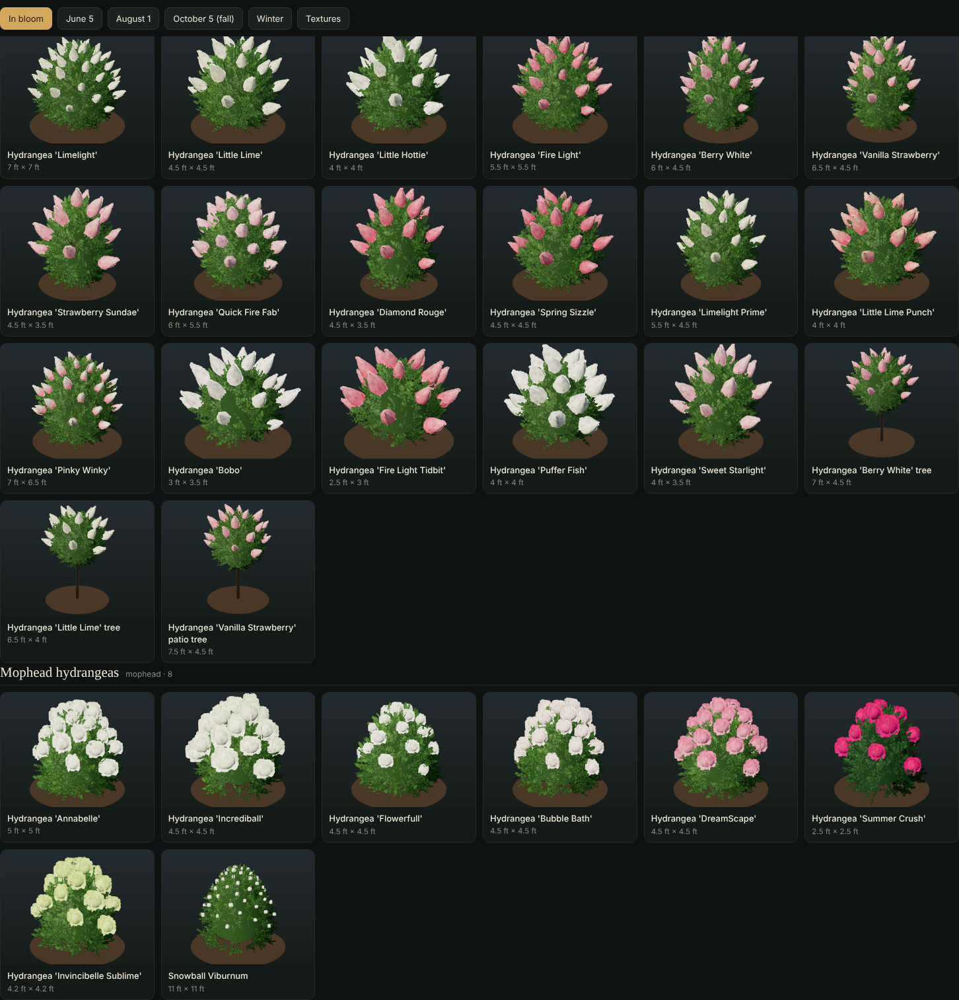
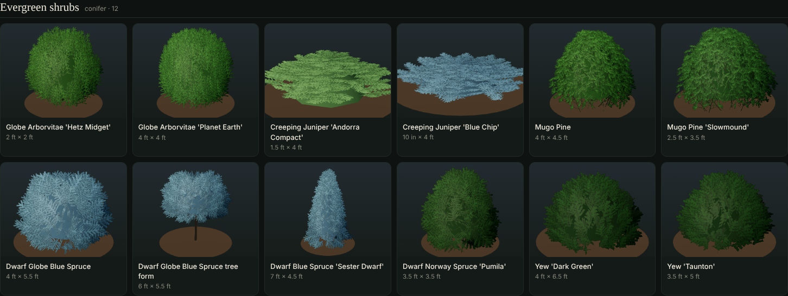

#### Plant models

Every variety is a preset on one of 24 parametric growth forms, built like the trees: alpha-tested cards with procedural leaf and flower textures, tubes for stems and a dark inner mass.

| Group | Growth forms |
| --- | --- |
| Perennials | Coneflowers & daisies, hostas, spikes, daylilies, tall clumps (bee balm, phlox, sedum, lilies), globes on stalks, peonies & bushy perennials, astilbes & ferns, ruffled mounds (coral bells, columbine), cushions, groundcover mats, upright grasses, fountain grasses, irises |
| Shrubs | Panicle hydrangeas, mophead hydrangeas, arching shrubs (weigela, forsythia), upright shrubs (dogwood, ninebark, viburnum, smokebush), cut-leaf shrubs (sumac, elderberry), mounding shrubs (spirea, potentilla), lilacs, small-leaved mounds (barberry, boxwood), columnar shrubs |
| Evergreen shrubs | One conifer model with five structures: globe (arborvitae, mugo pine, nest spruce), flat-topped globe (dwarf blue spruce), cone (dwarf Colorado spruce), spreading (creeping junipers, which turn plum in winter) and mounded yews; spruce, pine, arborvitae, juniper and yew foliage |
| Add-on | A standard trunk (`opt.trunk`, in feet) turns any shrub canopy into a patio tree |

`gallery.html` (with `npm run dev`, at `/gallery.html`) renders every preset in bloom, in June, in August, in fall and in winter, plus the texture sheet. It is a development page for checking models and is not part of the standalone build.

Sizes, zones and bloom dates are typical mature figures; check the tag of the plant you buy.

#### Adding plants and models

| To change | Edit | Notes |
| --- | --- | --- |
| The plant list | `src/garden/plants.js` | One row per variety in a `group()` that shares a model and defaults: name, size, flower colour, overrides. The header documents every field. |
| Growth forms and plan symbols | `src/garden/models.js` | `MODELS`: each form is a short function that calls shared generators (rosette, tuft, dome, stalks, bush, canes) and flower heads. |
| Leaf and flower textures | `src/garden/plantTextures.js` | Painted on a canvas: brightness in red, which of the plant's two colours in green, shape in alpha. One texture serves every colour. |
| How a bed is drawn | `src/garden/beds.js` | Outline, mulch, materials for the date, instancing. |
| Library pictures | `src/garden/thumbs.js` | Studio renders of single plants. |

In plan files a bed is `{type:"planting", x, y, rot, poly, smooth, mulch, plants:[{id, k, x, y}]}`: `k` is the catalog key and `x, y` are feet in the bed's own axes.

### Trees

| Group | Species |
| --- | --- |
| Maples | Autumn Blaze, Sienna Glen, Matador, Celebration, Silver, Sugar, Fall Fiesta, Inferno, Apollo (columnar), Emerald Lustre, Crimson King, Crimson Sunset, Royal Red, Flame and Ruby Slippers Amur, Hot Wings Tatarian (red winged seeds in summer) |
| Lindens | Redmond, Greenspire, Boulevard, Front Yard, Harvest Gold |
| Birches | Parkland Pillar and Dakota Pinnacle (columnar, white bark), River Birch and Northern Tribute (peeling cinnamon bark), Prairie Dream paper birch, single stem or clump |
| Oaks | Bur Oak, Swamp white oak, Prairie Stature, Crimson Spire and Regal Prince (columnar) |
| Elms | Prairie Expedition, Accolade, Cathedral, Princeton, Triumph, Valley Forge |
| Hackberries, honeylocusts, alders | Common Hackberry, Prairie Sentinel (columnar), Thornless and Northern Acclaim Honeylocust (fine leaflets, dappled shade), Prairie Horizon Alder |
| Poplars & aspens | Quaking Aspen, Prairie Gold, Summer Shimmer, Swedish Columnar Aspen, Hybrid Poplar, Robusta, Siouxland, Tower Poplar |
| Willows | Weeping Willow (hanging streamers), Prairie Reflection laurel willow |
| Crabapples | Prairifire, Adams, Courageous, Red Splendor, Rejoice, Royal Raindrops (single stem or clump), Starlite, Sparkling Sprite, Green Wall and Ivory Spear (columnar), and a generic flowering crab. Each blooms in its own colour for about two weeks from leaf-out |
| Cherries & pears | Amur Chokecherry, Klondike, Ming (coppery peeling bark, white flowers), Prairie Gem Pear |
| Small flowering trees | Winter King Hawthorn, Northern Redbud (single stem or clump), European Mountain Ash, Summerfrost Amur Maackia, Royal Purple and Golden Spirit smoke trees (a round head on a short trunk, with a haze of smoke through summer) |
| Tree lilacs | Japanese Tree Lilac clump, Ivory Silk, Snowdance: creamy plumes in early summer |
| Other shade trees | Early Glow Buckeye, Northern Catalpa, Rising Fire Hornbeam, Ironwood, KoolKat Katsura, Espresso Kentucky Coffeetree |
| Hydrangeas | Limelight, Pinky Winky tree forms: panicles from midsummer that go lime → white → pink into fall |
| Spruces | Norway (pendulous branchlets), Columnar Norway, Colorado Blue, Fat Albert, Black Hills, Meyer, Weeping White |
| Pines | Tannenbaum and Hyland Splendor Mugo, Columnar Mugo, Columnar Norway Pine |
| Junipers & arborvitae | Techny, Technito, Emerald Green, Holmstrup, North Pole, Pyramidal and Rushmore arborvitae; Spartan, Moonglow, Medora and Skyrocket junipers. Built as a tight skin of upright sprays on spire and teardrop crowns, with foliage to the ground |

A species can borrow another's foliage, carry its own flower form and bloom window, have its own bark, and grow as a three-stem clump (`lk`, `bk`, `bw`, `bark`, `clump` on its entry in `PRESETS`).

Flowering follows the leaf-out date and the hemisphere, so blossoms appear and drop with the season you pick.

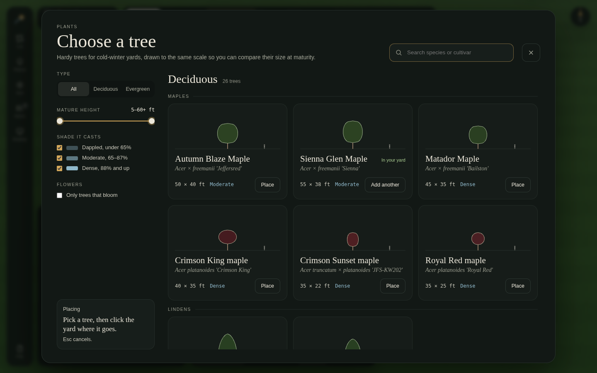
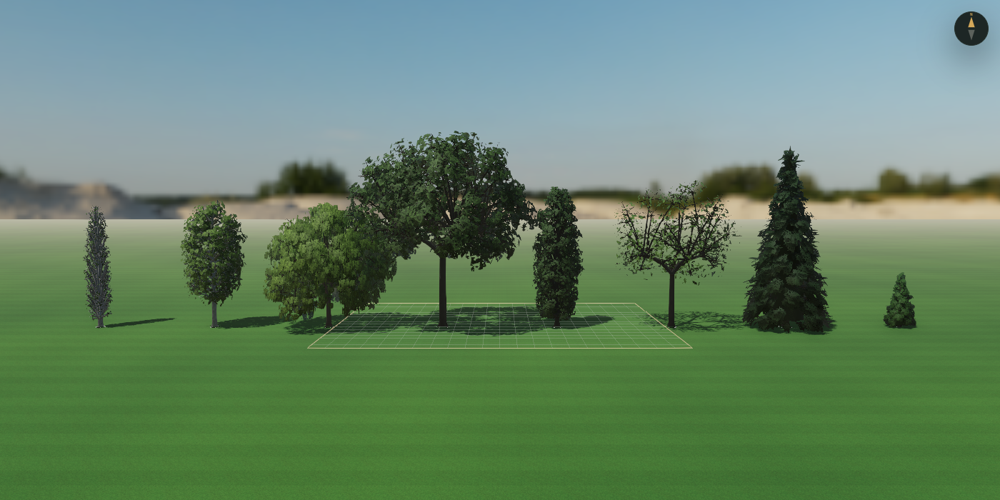
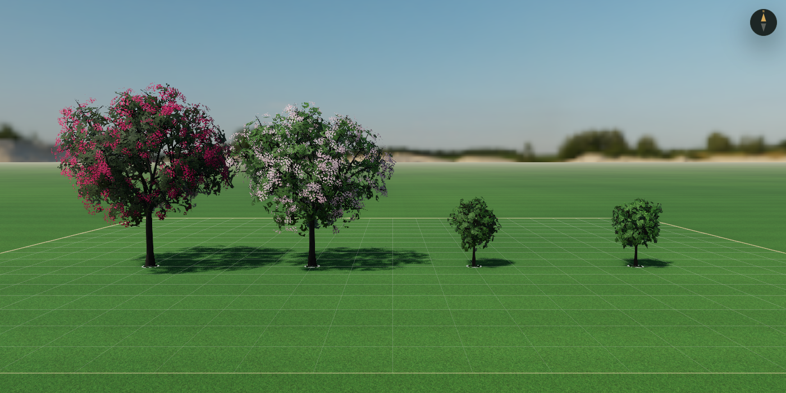
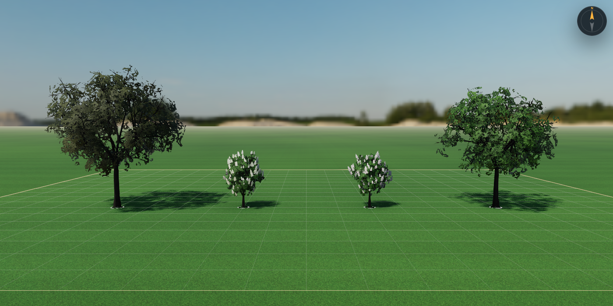
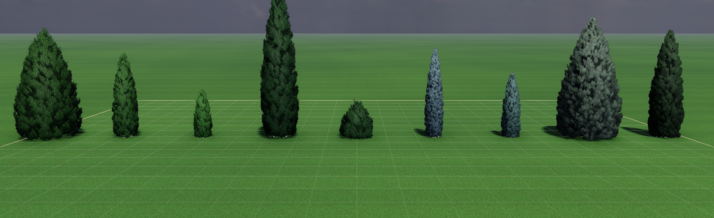
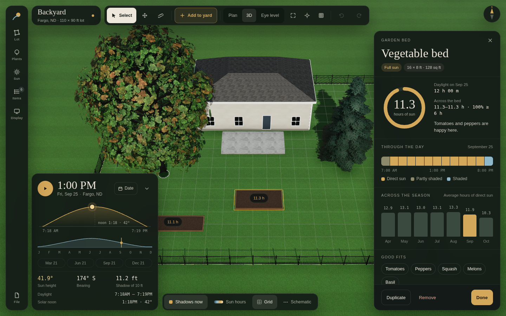

Plans are stored in feet. Display → Units switches everything on screen to metres (and growth rates to cm a year); the choice is saved in this browser.

## Location, clock and sun angles

The sun position comes from the original's NOAA-based solar maths. It matches suncalc to within 0.2° from Fargo to Sydney to Tromsø; the remaining difference is atmospheric refraction.

- **Location:**
  - Pick a preset, or type any latitude (−90 to 90) and longitude (−180 to 180). North and east are positive.
  - **Use my location** fills them in where the browser allows it.
- **Clock:**
  - **Time zone** (the default) uses the zone's own daylight-saving rules through the browser's time-zone data. That covers Phoenix (no DST), Europe and the southern hemisphere.
  - **Fixed UTC offset** keeps the original manual offset and its US daylight-saving switch. **Offset from longitude** suggests one.
  - If the clock is more than about 2.5 hours from what the longitude implies, the Clock section warns you, because every sun time would look wrong.
- **Edge cases:**
  - Inside the polar circles, the panel reports "Sun up all day" or "Sun below horizon all day" instead of inventing a sunrise.
  - South of the equator, leaf-out and leaf-drop dates shift six months, and the sun arcs through the north.

## Rendering

| Piece | Where |
| --- | --- |
| HDRI sky photo (the physical sky only as a fallback if no photo loads). The HDRI's sun is detected, clamped out of the lighting, and rotated to the solar-maths sun, with house angle vs. north applied. | `src/scene/environment.js` |
| RenderPass → N8AO → ACES → SMAA, half-float buffers, with no tone mapping on the renderer. It switches cleanly between the perspective and plan (orthographic) cameras. | `src/post.js` |
| Procedural trees built in feet from each tree's crown shape (the same profile the shade engine uses), height, spread and density. Broadleaves fill the crown with leaf clumps on a golden-angle spiral, then grow a symmetric skeleton (trunk, scaffold limbs or central leader, branches, winter twigs) to reach them. Conifers grow in whorls with their own habits: spruce (drooping layered sprays), juniper (dense upright scale foliage with berries), pine and mugo (needle tufts, mugo multi-stemmed). Each variety grows consistently, with small per-tree variation in limbs, clump placement and crown outline so plantings don't look cloned. Foliage is a mix of small and medium leaf sprays. Interior leaves are shaded darker; fall colour starts on the sun-facing outer leaves. EZ-Tree supplies only the bark textures. | `src/trees/trees.js` |
| Buildings: foundation, corner boards, fascia and soffit, windows and a door on the wall facing the patio, generated for any outline and merged into a few draw calls | `src/app.js` (`buildingDetails`) |
| Procedural foliage per species. Broadleaf clusters: maple, linden, alder, birch, aspen, poplar, hackberry, elm, bur oak, white oak, swamp white oak, crabapple, hydrangea and general broadleaf. Also honeylocust fronds and willow streamers. Conifer sprays: spruce, juniper, arborvitae and mugo pine. Flower textures: crabapple blossoms and hydrangea panicles. Standard 1024 px, or 2048 px with High tree detail. | `src/trees/leafTextures.js` |
| Procedural lawn (blade strokes plus normal map, mowing stripes along the grid), concrete, pavers, siding and shingles | `src/scene/textures.js` |

- **Sun-hours numbers:** the original's analytic shade engine calculates them. The 3D shadows are for looking; the numbers don't depend on them.
- **Heat-map colours:** they're pre-compensated for the tone curve, so the colour ramp reads the same in the realistic and simple views.
- **Display settings** (render quality, sky and exposure) are saved per browser, not in plan files.

## Performance

- **Renders on demand.** Nothing draws unless something changes: the camera, the sun, the plan or a setting. When idle, the GPU does no work.
- **Shadows only when needed.** The shadow map re-renders only when the sun or the yard changes, never for camera moves.
- **Lighter while moving.** While you orbit, drag or play the day, frames render at 1× resolution without ambient occlusion. One full-quality frame follows when the view settles.
- **No wind and no grass geometry.** The lawn is a texture, not millions of blades.
- **Tree detail** is separate from render quality: Standard, or High (2048 px foliage and about twice the leaf sprays).
- **Render quality presets** in the Display section:

| Preset | Resolution | Ambient occlusion | Shadow map |
| --- | --- | --- | --- |
| Performance | 1× | off | 2048 |
| Balanced (default) | up to 1.5× | half resolution | 4096 |
| Quality | display resolution | full | 4096 |
